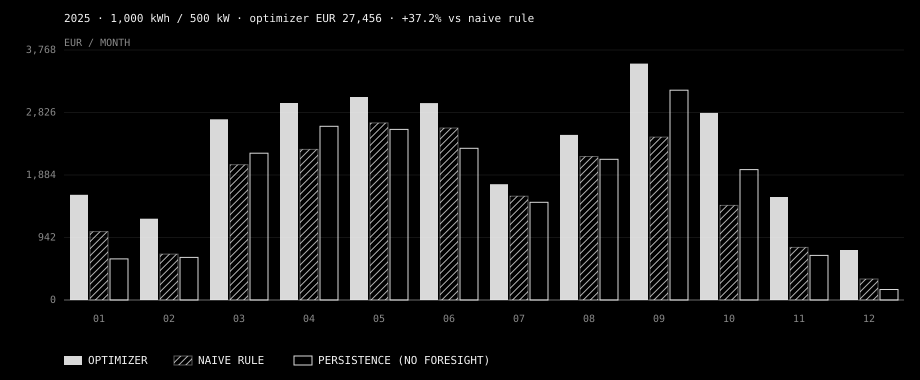
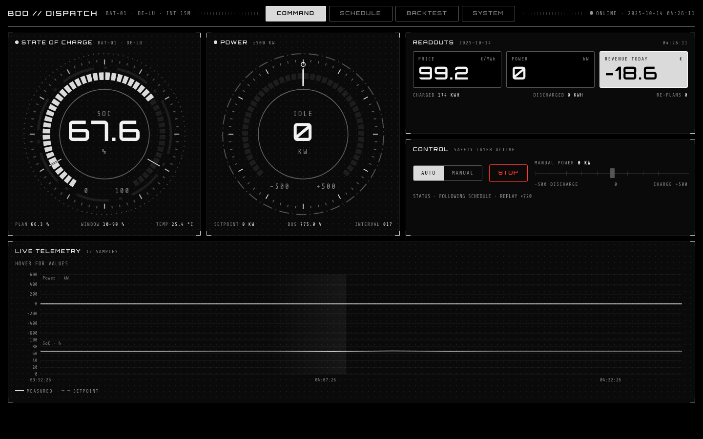
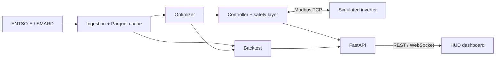
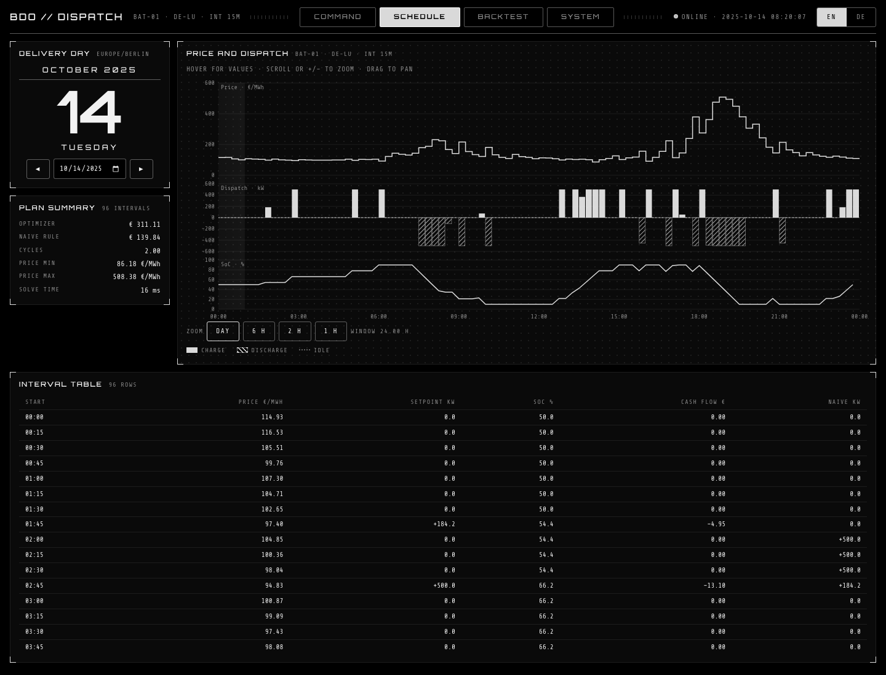
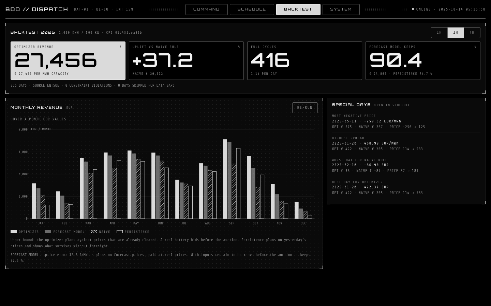

# Battery Dispatch Optimizer

A 1 MWh / 500 kW battery scheduled against real German power prices, backtested over all of
2025, and driven as a simulated inverter over Modbus TCP. Zero constraint violations in every
run.

**[Watch the 3-minute demo](https://youtu.be/YaK6x80I544)**

| 2025, real DE-LU prices | Revenue | What it shows |
| --- | ---: | --- |
| Naive rule (4 cheapest / 4 most expensive hours) | € 20,012 | the baseline |
| **Optimizer, day-ahead** | **€ 27,456** | **+37.2 % from better scheduling, same information** |
| Optimizer on its own price forecast | € 24,807 | 90.4 % survives without knowing prices in advance |
| Optimizer, day-ahead + FCR + aFRR | € 82,158 | about € 164,000 per MW when balancing capacity is added |



> **These are upper bounds, and the README says where.** The optimizer rows plan against
> prices that are already cleared; a real battery bids before the auction. The forecast row is
> the honest version of the day-ahead number. The multi-market row counts capacity payments
> only. Details and caveats are in the sections below.

The dashboard is a monochrome HUD in English and German. It shows the loop live: price,
schedule, setpoint over Modbus, measured power, revenue.



## Run it

```bash
cp .env.example .env        # optional: add an ENTSO-E token; without one SMARD is used
docker compose up --build   # then open http://localhost:8080
```

The first start downloads six years of prices, runs three backtests and trains the price
forecaster (several minutes; set `BDO_INIT_FORECAST=false` in `.env` for about two).
After that the controller replays 14 Oct 2025 against the simulator in a two-minute loop.
Set `BDO_SPEED=1` and `BDO_REPLAY_DAY=` in `.env` for live mode against today's prices.

Without Docker:

```bash
make setup      # Python 3.12 venv + npm ci
make test       # 163 tests, coverage gate on optimizer and controller
make backtest   # writes data/runs/2025-<config hash>/ with CSV, JSON and report.html
make sweep      # 1 h / 2 h / 4 h x three efficiencies
make dev        # simulator, controller, API, dashboard on http://127.0.0.1:5173
make e2e        # Playwright against the running stack
```

## What is in the box

| Area | What it does |
| --- | --- |
| Data | ENTSO-E and SMARD clients, Parquet cache queried with DuckDB, hourly and 15-minute products, gap and duplicate report. Prices are never interpolated. |
| Optimizer | cvxpy + HiGHS. Arbitrage, degradation cost, grid fees, monthly peak demand charge, on-site solar, cycle limit, end-of-day SoC. One day solves in about 10 ms. |
| Backtest | Day-by-day replay with SoC carried over midnight, three strategies, daily / monthly / yearly metrics, special days, scenario sweep, deterministic output keyed by config hash. |
| Device | pymodbus simulator with battery physics and noise, dispatch controller, safety layer, accelerated time. |
| Dashboard | React + TypeScript + hand-built SVG. Four screens: COMMAND, SCHEDULE, BACKTEST, SYSTEM. |

### Scenario sweep, 2025

| Duration | Round trip | Optimizer | Naive | Uplift | € per MWh capacity |
| --- | ---: | ---: | ---: | ---: | ---: |
| 1 h | 90 % | € 15,053 | € 8,697 | +73.1 % | 30,106 |
| 2 h | 85 % | € 25,044 | € 18,317 | +36.7 % | 25,044 |
| 2 h | 90 % | € 27,338 | € 19,933 | +37.2 % | 27,338 |
| 2 h | 95 % | € 29,756 | € 21,486 | +38.5 % | 29,756 |
| 4 h | 90 % | € 44,582 | € 40,207 | +10.9 % | 22,291 |

Longer batteries earn more in total and less per MWh, and the naive rule catches up: with four
hours of storage, "four cheapest, four most expensive" is already close to the best plan.

### Special days in 2025

| Day | Date | Optimizer | Naive |
| --- | --- | ---: | ---: |
| Most negative price (−250.32 €/MWh) | 11 May | € 275 | € 267 |
| Highest spread (469 €/MWh) | 20 Jan | € 422 | € 205 |
| Worst day for the naive rule | 10 Feb | € 36 | −€ 87 |

## Price forecaster

The headline assumes perfect foresight. `bdo forecast` replaces that with a model: it
forecasts each day's prices from information available before the auction, plans on the
forecast, and is paid at the real prices.

| 2 h battery | 2025 revenue | 2025 share of perfect foresight | 2026 to 6 Oct, share |
| --- | ---: | ---: | ---: |
| Perfect foresight (optimizer) | € 27,456 | 100 % | 100 % |
| **Model with load, wind and solar forecasts** | **€ 24,807** | **90.4 %** | **89.2 %** |
| Model on past prices and calendar only | € 22,651 | 82.5 % | 79.9 % |
| Persistence (yesterday's prices) | € 20,501 | 74.7 % | 80.5 % |

Hourly price error (MAE) in 2025: 12.2 €/MWh for the full model, 21.3 for prices only, 26.0
for persistence.

- **Hourly model:** gradient-boosted trees (scikit-learn), one model for all hours, retrained
  at the start of every month on the previous four years. Inputs are the prices of the previous
  days, weekday, public holidays, season, and the TSOs' day-ahead forecasts of load, wind and
  solar from SMARD.
- **Intra-hour model:** since October 2025 the market clears in 15-minute products, and about
  a quarter of the arbitrage value sits in how the four quarter-hours deviate from the hourly
  mean. A second model forecasts that deviation from the 15-minute load, wind and solar
  forecasts and is retrained every week.
- **Which period is a fair test:** settings for the hourly model were chosen on 2024. The
  intra-hour model was developed on Q4 2025, so that quarter is not a clean test for it; it
  keeps 74.6 % there, up from 71.4 % without it. 2026 is untouched by any tuning and is all
  15-minute prices.
- **Timing caveat:** the TSO wind and solar forecasts are published in the evening of the day
  before delivery, after the noon auction. They stand in for the weather forecasts a trader
  would have in the morning. The prices-only row uses nothing but data that is certainly
  available in time, and in 2026 it does not beat persistence.

```bash
make forecast   # needs 2020-2025 history from SMARD; the first run downloads it
```

In the dashboard, BACKTEST shows the model as a fourth series. It is trained on first start
by default; with `BDO_INIT_FORECAST=false` it can be started from the button there instead.

## Multi-market (v2): FCR, aFRR and imbalance

Day-ahead arbitrage is only part of what a battery earns. With `--markets` the optimizer also
sells balancing capacity in the same problem: FCR (symmetric) and aFRR up and down, each as
one constant band per 4-hour block. Capacity prices and imbalance prices come from ENTSO-E,
so this part needs the token.

| 2025, 1 MWh / 500 kW | Revenue | Per MW of power |
| --- | ---: | ---: |
| Day-ahead only | € 27,456 | € 54,912 |
| **Multi-market** | **€ 82,158** | **€ 164,315** |
| of which day-ahead energy, after wear | € 12,256 | |
| of which FCR, after wear | € 49,127 | |
| of which aFRR up / down | € 11,263 / € 9,512 | |

Zero constraint violations over 365 days. A sold band must be deliverable at every moment:
the day-ahead position plus the band has to fit the inverter and the grid connection, and
enough energy must sit behind it. How much energy is the assumption that moves the result
most:

| Energy held per kW of aFRR sold | Revenue | Per MW of power |
| --- | ---: | ---: |
| FCR only, no aFRR | € 71,978 | € 143,957 |
| 4 h, the whole product (default) | € 82,158 | € 164,315 |
| 2 h | € 97,400 | € 194,800 |
| 1 h | € 130,748 | € 261,496 |

**This is an upper bound, more so than the day-ahead number.**

- It uses cleared prices with perfect foresight of three auctions that close at different
  times, FCR and aFRR before the day-ahead auction.
- It counts capacity payments only. aFRR activation energy, its revenue and its effect on the
  state of charge are not modelled. FCR activation is a small wear cost.
- aFRR capacity is pay-as-bid; the published average price is assumed for every kW.
- The minimum bid is 1 MW, so a 500 kW unit would be pooled by an aggregator.
- The controller does not respond to grid frequency. It holds the day-ahead schedule.

**Imbalance.** Energy that differs from the schedule is settled at the imbalance price
(reBAP) instead of the day-ahead price. In 2025 the two were on average € 51 per MWh apart,
and within € 126 in 95 % of quarter-hours. COMMAND shows the energy off schedule and, when
the price for that day is published, the settlement effect.

```bash
bdo backtest --year 2025 --markets            # needs ENTSOE_TOKEN
bdo backtest --year 2025 --markets --duration 4
```

## Is this a business?

Not on day-ahead trading alone. € 27,456 a year on a battery that costs several hundred
thousand euro installed does not repay it within its life. The multi-market result is in the
range that published German revenue indices show for 2-hour batteries, roughly € 100,000 to
€ 200,000 per MW a year, and that stacking is why batteries are being built. Costs, taxes,
financing, grid connection charges and market fees are outside this model, and every new
battery narrows the spreads and reserve prices it lives on.

## Design decisions

- **Binary variable against simultaneous charge and discharge.** With negative prices a plain
  LP is paid to consume, so it charges and discharges at once to burn energy in the conversion
  losses. A cost penalty would have to exceed the most negative price ever seen. One binary per
  interval removes the behaviour and the day still solves in milliseconds.
- **Every strategy is settled by the same physics function.** The solver's plan is passed
  through `settle()`, which clamps to power, SoC and grid limits and prices the result. The
  baselines go through the same function, so the comparison is like for like.
- **Peak shaving in a rolling horizon.** Each day's problem carries the month-to-date peak as a
  parameter and only pays the demand charge on an increase above it.
- **The controller is the only thing that touches the device.** Manual overrides from the
  dashboard pass through the same `safe_setpoint()` as scheduled ones.

## Safety layer

`backend/bdo/device/safety.py` is one pure function. It forces 0 kW when

- the fault register is non-zero,
- no telemetry has arrived for more than 30 s,
- the schedule is stale or has no entry for the current time,
- the operator pressed STOP (two-step in the UI),

and otherwise clamps the request to the power limits and the SoC window. Each rule has a unit
test, and `test_full_loop_over_modbus_tcp` proves fault and link loss against a real Modbus
TCP server.

## Modbus register map

Full table: [docs/register-map.md](docs/register-map.md) (generated from
`backend/bdo/device/registers.py`).

| Addr | Name | Kind | Scale | Meaning |
| --- | --- | --- | --- | --- |
| IR 0 | SOC | uint16 | 0.01 % | State of charge |
| IR 1 | W | int16 | 0.1 kW | Actual power, positive = charging |
| IR 2 | V | uint16 | 0.1 V | DC bus voltage |
| IR 3 | TMP | int16 | 0.1 °C | Cell temperature |
| IR 4 | FAULT | bitfield | | Over-temperature, device fault, comm watchdog |
| HR 0 | WSET | int16 | 0.1 kW | Power setpoint, positive = charging |

Point names follow SunSpec storage models. The layout does not: SunSpec keeps every point in
holding registers behind a `SunS` marker, this map keeps telemetry in input registers.

To point the controller at real hardware, change `controller.modbus_host`, `modbus_port` and
`modbus_unit` in the config and adapt the addresses in `registers.py`.

## Architecture



More in [docs/architecture.md](docs/architecture.md).

## Dashboard

Monochrome only: black background, white and grey lines, one red accent reserved for faults
and safety stops. Charge is a solid bar above the axis, discharge a hatched bar below it, idle
a dotted line. All motion stops under `prefers-reduced-motion`. On a phone only COMMAND shows.

| SCHEDULE | BACKTEST |
| --- | --- |
|  |  |

## Limitations

- **Perfect foresight.** The headline is an upper bound; see the price forecaster section for
  what a model keeps of it. The dashboard and the controller still plan on cleared prices.
- **Markets.** v1 is day-ahead only. v2 adds FCR and aFRR capacity as described above.
  Continuous intraday trading, mFRR and aFRR energy are not modelled.
- **No real market access.** Nothing here bids, trades or settles.
- **Price source.** With an `ENTSOE_TOKEN` the code reads ENTSO-E, otherwise SMARD. For
  2025 the two agree on all 15,411 intervals and give the same backtest result. The
  forecaster always uses SMARD, because its load, wind and solar inputs come from there.
- **Load profile.** The commercial load in `config/site.yaml` is a synthetic profile shaped
  like BDEW G0, not the official table.
- **Degradation** is a flat cost per kWh of throughput. No calendar ageing, no depth-of-discharge
  effect.
- **The simulator is not a certified device model** and the safety layer is not a certified
  protection system. Do not connect this to real hardware without independent protection.
- **Accelerated mode** keeps the 30 s link timeout in wall-clock seconds.

## Kurzfassung (Deutsch)

Dieses Projekt plant den Einsatz eines Batteriespeichers (1 MWh / 500 kW) am deutschen
Day-Ahead-Markt (Gebotszone DE-LU) mit einem gemischt-ganzzahligen linearen Programm. Im
Backtest über das gesamte Jahr 2025 erzielt der Optimierer 37,2 % mehr Erlös als eine einfache
Regel (laden in den vier günstigsten, entladen in den vier teuersten Stunden) und verletzt
dabei keine technische Grenze. Der Fahrplan wird anschließend über Modbus TCP an einen
simulierten Wechselrichter übergeben; eine Sicherheitsschicht setzt die Leistung bei Störung,
Verbindungsverlust oder veraltetem Fahrplan auf 0 kW. Das Ergebnis ist eine Obergrenze, weil
gegen bereits bekannte Preise optimiert wird.

## License

MIT. See [LICENSE](LICENSE).
