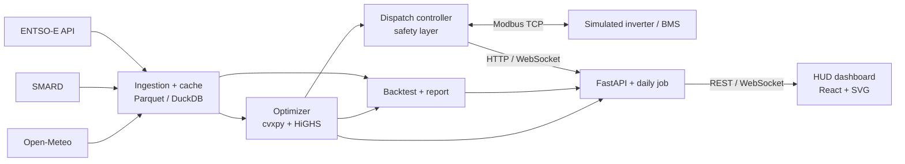

# Architecture

## Components

| Component | Code | Runs as |
| --- | --- | --- |
| Ingestion and cache | `backend/bdo/data/` (prices, fundamentals, reserves, imbalance) | library, `data` init container |
| Price forecaster | `backend/bdo/forecast/` | CLI, `data` init container, API |
| Optimizer | `backend/bdo/optimizer/` | library |
| Backtest and report | `backend/bdo/backtest/` | CLI, `data` init container |
| Simulated inverter | `backend/bdo/device/simulator.py` | `simulator` service, Modbus TCP :5020 |
| Dispatch controller | `backend/bdo/device/controller.py`, `safety.py`, `service.py` | `controller` service, internal :8100 |
| Public API and daily job | `backend/bdo/api/main.py` | `api` service, :8000 |
| Dashboard | `frontend/` | `web` service (nginx), :8080 |

## Rules the code keeps

- **One gate to the device.** Only the controller opens a Modbus connection. The API forwards
  mode changes and manual setpoints to the controller, where `safe_setpoint()` decides what is
  written. The safety layer lives in `device/safety.py` and nowhere else.
- **One accounting path.** Optimizer, naive rule and persistence are all priced by
  `optimizer/schedule.py::settle`, which clamps any request to the battery physics. A strategy
  cannot earn money from an infeasible plan.
- **UTC inside, Berlin at the edges.** Timestamps are stored and computed in UTC. Delivery days
  are cut at Berlin midnight, so they have 23, 24 or 25 hours.
- **Sold reserve is deliverable.** In the multi-market mode the day-ahead position plus every
  band sold must fit the inverter and the grid connection, with energy behind it, in every
  interval. `check_constraints` verifies it independently of the solver.
- **No invented prices.** Gaps and duplicates are reported and the affected day is skipped.

## Data flow for one day

1. 13:15 Europe/Berlin: the daily job fetches tomorrow's prices into the Parquet cache.
2. At local midnight the controller loads the day's prices, reads the battery's SoC over Modbus
   and solves the day.
3. At each interval boundary it writes the setpoint, then polls telemetry every 2 s.
4. If measured SoC drifts more than 5 % from plan it re-solves the rest of the day.
5. Every decision is logged as one structured line: interval, setpoint, reason, measured power.
